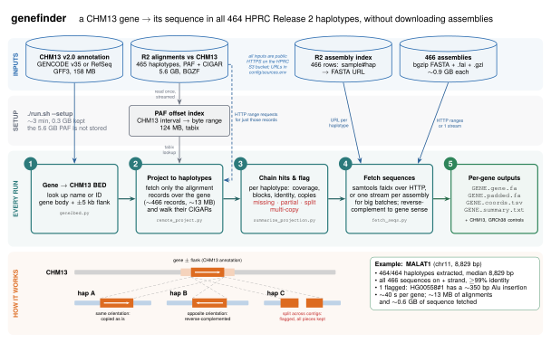

# genefinder

Extract the sequence of any CHM13 v2.0-annotated gene from **every HPRC Release 2 haplotype assembly** (464 haplotypes, plus CHM13 and GRCh38 as controls), **without downloading assemblies or the 5.6 GB alignment file**.

<p align="center">
  
</p>
<p align="center"><sub>Figure source: <a href="docs/figures/pipeline.tex">docs/figures/pipeline.tex</a> (TikZ) · <a href="docs/figures/pipeline.pdf">PDF</a> · <a href="docs/figures/pipeline.png">PNG</a></sub></p>

The numbered steps match the figure:
1. **Look up the gene.** Genes are found in the CHM13 v2.0 GENCODE (or RefSeq) annotation using the annotation's own coordinates, and a ±5 kb flank is added.
2. **Project.** The gene interval is projected onto every haplotype through the Release 2 alignments (`hprc465vschm13.aln.paf.gz`). Only the few MB of alignment records that overlap the gene are fetched, located through a small offset index that setup builds once.
3. **Chain and flag.** Each haplotype is reported as ok, missing, partial, split across contigs or alignment blocks, or multi-copy. Nothing is dropped silently.
4. **Fetch.** The matching interval is read from each haplotype's assembly on the public HPRC bucket, in the gene's sense orientation.
5. **Write outputs.** Each gene gets FASTA files, a coordinate table and a summary, with CHM13 and GRCh38 as controls.

All inputs are public HTTPS. **[docs/DATA_SOURCES.md](docs/DATA_SOURCES.md)** lists every file, URL, size and checksum, and they are all set in [`config/sources.env`](config/sources.env).

## Requirements

- Linux or macOS (x86_64 or arm64), with `bash` and `curl`.
- A conda environment with the tools in [`environment.yml`](environment.yml) (top-level versions pinned), or, for an exact copy of the tested environment, an explicit lock file for your platform: `conda create -n genefinder --file envs/genefinder.<linux-64|osx-64|osx-arm64>.lock.txt` (see [envs/README.md](envs/README.md)):
  - Python ≥ 3.9 (standard library only)
  - samtools/htslib ≥ 1.16 with libcurl; the bioconda builds have it
  - optional: minimap2 for validation, impg for `--mode impg`
- About **0.3 GB of disk** for the one-time data, and outbound HTTPS to `human-pangenomics.s3.amazonaws.com`.
- Optional: GNU time for per-step resource logs. Linux has `/usr/bin/time`; on macOS run `brew install gnu-time`.

## Quick start

```bash
git clone https://github.com/hongsheng-lai/genefinder.git
cd genefinder
conda env create -f environment.yml && conda activate genefinder

scripts/check_sources.sh            # optional: verify the remote data is reachable / unchanged
./run.sh --setup                    # one time: ~0.3 GB kept (reads the 5.6 GB PAF once to build its offset index)
./run.sh MALAT1                     # results in ./genefinder_out/genes/MALAT1/
scripts/validate.sh MALAT1          # minimap2 a sample of the sequences against CHM13 (expect + strand, >99% id)
```

More examples:

```bash
./run.sh MALAT1 NEAT1 GAPDH --outdir results -j 32       # several genes, 32 parallel jobs
./run.sh --gene-list genes.txt --annotation refseq        # a list (first column = gene name or ID)
./run.sh --setup --full                                   # optional: store PAF + impg index (6.3 GB) for huge batches
./run.sh --biotype protein_coding ALL --mode impg --fetch stream -j 64   # the whole annotation (see "Scaling")
```

### On the Salz cluster (no downloads)

The 466 Release 2 assemblies are mirrored in `/ccb/salz8/HPRC/assemblies/fasta/` (bgzip + `.fai` + `.gzi`, same file names as the assembly index). When that directory exists, `run.sh` reads sequences from it with local `samtools faidx` instead of S3, and with a stored PAF (`--setup --full`) `--mode auto` projects with impg. `--offline` makes this strict: it stops instead of touching the network.

```bash
export PATH=/ccb/salz4-2/hlai21/genefinder/tools/env-clean/bin:$PATH   # shared env built from envs/genefinder.linux-64.lock.txt
./run.sh MALAT1 --offline -j 32      # MALAT1: ~33 s total, 7 s fetch (vs ~42 s fetch from S3); same sequences
```

Another mirror: `--fasta-dir DIR` or `export LOCAL_FASTA_DIR=DIR`. `--fasta-dir none` forces S3. An assembly missing from the mirror is read from S3 (or, with `--offline`, the run stops and lists it).

- **Lookup:** genes are matched by `gene_name`, `Name`, `gene`, `gene_id`, `ID`, or Ensembl ID (with or without version).
- **Reporting:** genes that aren't found, or that match several annotated loci, are reported in `work/<batch>/batch.lookup.txt`. Extra loci become `<GENE>_copy2` and so on.
- **Rerunning:** reruns resume. Assemblies already fetched in a batch are skipped, and failures are retried.

### Options (`./run.sh --help`)

| Option | Default | Meaning |
|---|---|---|
| `--outdir DIR` | `./genefinder_out` | results |
| `--data-dir DIR` | `<repo>/data` (`$GENEFINDER_DATA`) | one-time data from `--setup` |
| `--annotation gencode\|refseq\|PATH` | `gencode` | CHM13 v2.0 GFF3 (GENCODE v35 CAT/Liftoff, or RefSeq Liftoff, downloaded on first use) |
| `--flank N` | 5000 | flank on each side for `*.padded.fa` |
| `--biotype B` | – | keep only genes with this biotype (e.g. `protein_coding`) |
| `--mode auto\|remote\|impg\|local\|stream` | `auto` | projection engine (see below); `auto` = impg if the PAF is stored and impg is installed, else local if the PAF is stored, else remote |
| `--fasta-dir DIR\|none` | `$LOCAL_FASTA_DIR` if it exists (`/ccb/salz8/HPRC/assemblies/fasta`) | local copies of the assemblies; `none` = S3 |
| `--offline` | off | no network: require a stored PAF and every assembly in `--fasta-dir` |
| `--fetch auto\|faidx\|stream` | `auto` | sequence access (see below) |
| `-j N` | 16 | parallel requests and processes; everything remote is latency-bound, so 32–64 is faster |
| `--batch NAME` | first gene / list name | names `work/` and `logs/` subdirectories |

## Outputs

Each gene gets a folder, `OUTDIR/genes/<GENE>/`:

| File | Content |
|---|---|
| `<GENE>.gene.fa` | gene body from each haplotype, **in the gene's sense orientation** (reverse-complemented where needed). Header: `>GENE\|sample#hap#contig:start-end(strand)`, 1-based inclusive, with strand = the gene's orientation on that contig. CHM13 comes first, then GRCh38, then HPRC. Extra copies or fragments get a suffix (` copy2`, ` fragment3`). |
| `<GENE>.padded.fa` | the same hits ± flank |
| `<GENE>.coords.tsv` | one row per hit and per missing haplotype; columns listed below |
| `<GENE>.summary.txt` | counts (attempted, extracted, ok, missing, partial, split, multi-copy), length distribution, controls, and every flagged haplotype with its hits |

Columns of `coords.tsv`:
- `gene`, `sample`, `hap`, `contig`
- `start`, `end`: 0-based, half-open
- `strand`
- `gene_cov_frac`: CHM13 gene bases covered
- `n_blocks`
- `identity`: matches / (matches + mismatches + gap opens)
- `padded_start`, `padded_end`, `length`
- `hit_class`: primary, copy or fragment
- `hap_status`, `extracted`, `fasta_header`

`OUTDIR/work/<batch>/` holds the intermediates: BEDs, `projection.paf`, `regions.tsv`, the fetch log and `batch_summary.tsv`. `OUTDIR/logs/<batch>/` holds the GNU `time -v` log of every step and `resources.tsv`, when GNU time is available.

### Haplotype status flags

Flags are comma-separated.

| Flag | Meaning |
|---|---|
| `ok` | one hit, one contig, one alignment block, ≥ 95% of the gene covered |
| `missing` | no alignment covers the gene. Expected for chrX genes in male paternal haplotypes, and for chrY-PAR genes (masked in the CHM13 target). |
| `partial` | best hit covers < 95% of the gene; all fragments are then extracted |
| `split_contigs` | the gene is only covered by combining hits on more than one contig |
| `split_blocks` | the primary hit is made of more than one alignment piece, usually an indel or SV inside the gene. The sequence is still complete. |
| `multi_copy` | more than one hit covers ≥ 50% of the gene; every copy is extracted |
| `control` | CHM13 itself |

## How it works

| Step | Script | Notes |
|---|---|---|
| setup | `scripts/setup.sh`, `build_paf_index.py` | tool check, environment report, small downloads; the PAF offset index (one sequential read of the PAF; only the index is kept) |
| genes → BED6 | `scripts/gene2bed.py` | `CHM13#0#chrN`, 0-based; gene and padded BEDs; not-found / multi-hit report |
| projection | `scripts/remote_project.py` | `tabix` finds the PAF records overlapping the genes. Their byte ranges are fetched from S3 and the `cg:Z` CIGARs are walked in Python (`paf_project.py`). |
| | `scripts/impg_project.sh`, `stream_project.sh` | alternatives: `impg query` on the stored PAF, or streaming the whole PAF |
| hits and flags | `scripts/summarize_projection.py` | chains pieces per haplotype, contig and strand. A new hit starts if pieces are > 20 kb apart or re-cover CHM13 bases (a tandem copy). |
| fetch | `scripts/fetch_seqs.py`, `stream_extract.py` | one job per assembly per batch; the gene is sliced from its padded interval; retries; resume |
| summaries | `scripts/gene_summary.py` | `summary.txt` and `batch_summary.tsv` |
| validation | `scripts/validate.sh GENE [N] [OUTDIR]` | minimap2 of sampled sequences (plus GRCh38 and reverse-strand hits) against the CHM13 gene |
| utilities | `scripts/check_sources.sh`, `scripts/s3ls.py`, `scripts/resources.py` | check URLs, list the bucket, collect time logs |

### Choosing a projection mode

All four modes produce the same intervals. impg can differ by 1 bp at a gene end when an insertion sits exactly on the boundary.

| `--mode` | Stored data | MALAT1 | Best for |
|---|---|---|---|
| `remote` (`auto` without a stored PAF) | offset index, 0.12 GB | ~12 s at `-j 16`, ~13 MB fetched | one to a few thousand genes |
| `impg` (`auto` with a stored PAF) | PAF + impg index, 6.3 GB (`--setup --full`) | 0.2 s | very large batches (all genes) |
| `local` | PAF, 5.6 GB (`--setup --full`) | ~20 s | large batches without impg |
| `stream` | nothing | ~12 min, 5.6 GB downloaded per run | no setup at all |

For a single gene, about 466 alignment records overlap it (one per haplotype). Each record covers ~2.4 Mb of CHM13, so `remote` needs ~0.03% of the alignment file.

### Choosing a fetch method

- **`faidx`:** HTTP range requests to each remote assembly. It's latency-bound at about 0.4 s and 0.2 MB per region, so cost grows with the number of genes. Best for up to a few hundred genes.
- **`stream`:** reads each assembly once (~0.9 GB, ~20–40 s) and extracts every region of the batch in that pass. The cost is fixed at ~420 GB of transfer per batch, however many genes it holds. Best for thousands of genes.
- **`auto` (default):** streams an assembly when the batch needs more than 3,000 regions from it. Local assemblies (`--fasta-dir`) always use `faidx`, which has no latency cost there.

## Performance

Reference run: Linux, 128 CPUs, NFS storage.

| | wall | peak RAM | network | disk |
|---|---|---|---|---|
| One-time setup (default) | ~3 min (reading the 5.6 GB PAF once to build the offset index) | ~1 GB | ~5.8 GB | ~0.3 GB |
| One-time setup `--full` (adds PAF + `impg index`) | +~17 min | 5.5 GB | — | +6.3 GB |
| One gene (MALAT1, 466 assemblies, `-j 64`, default remote mode) | ~41 s (12 s annotation scan, 6.5 s projection, 22 s fetch) | < 100 MB | ~0.6 GB | 13 MB |
| 200 protein-coding genes (`-j 64`, faidx) | ~15 min | ~0.75 GB¹ | ~20 GB | ~16 GB (~4 GB bgzipped) |

¹ Measured for the bounded-memory fetch step on a 64-assembly × 200-gene batch.

For MALAT1, 464/464 haplotypes were extracted. The median length was 8,829 bp (equal to CHM13), and all 466 sequences align to CHM13 on the + strand at ≥ 99% identity. The one outlier, HG00558#1 at 9,190 bp, carries a polymorphic Alu insertion and is flagged `split_blocks`.

### Scaling to all genes

| Gene set | Sequence per haplotype (gene + padded) | Uncompressed FASTA, all haplotypes |
|---|---|---|
| All ~64k GENCODE genes | ~4.6 Gb | ~2.2 TB |
| Protein-coding (~20k) | ~2.9 Gb | ~1.4 TB |

- **Projection:** use `--setup --full --mode impg -j 64`, which takes minutes. With `remote`, the number of range requests grows with the number of genes.
- **Fetching:** use `--fetch stream` with large batches, so that each ~420 GB pass over the assemblies serves many genes.
- **Expect output volume to be the bottleneck.** The final write and summary steps are currently single-threaded (~60 MB/s), and the hits/flags step holds ~1.4 MB per gene in memory, so keep batches to ≤ 5–10k genes.

## Caveats

- **Boundaries.** Gene boundaries come from the alignments, so assembly errors and alignment breaks show up as `partial`, `split_*` or `multi_copy`. Check `summary.txt` before using sequences from difficult loci (LPA, AMY1, SMN, NBPF, …).
- **Identity metrics.** `identity` in `coords.tsv` is gap-compressed. minimap2 identity in `validate.sh` counts every indel base, so carriers of structural variants score lower.
- **chrY.** The CHM13 alignment target has the chrY PARs hard-masked, so PAR genes are projected only via their chrX copy.
- **Index validity.** The offset index is tied to the exact PAF file (byte offsets). If `PAF_URL` changes, rerun `./run.sh --setup` after deleting `data/paf/hprc465vschm13.offsets.bed.gz*`.

## Tests

```bash
python3 -m unittest discover -s tests -v   # offline unit tests: CIGAR projection, offset index + range fetch,
                                           # stream extraction, hit chaining
```

## Acknowledgements and citation

This tool only re-uses public data and tools. Please cite:
- the **Human Pangenome Reference Consortium** (Release 2 assemblies and alignments)
- the **T2T Consortium** (CHM13 v2.0 and its CAT/Liftoff annotations)
- **impg**, **samtools/htslib** and **minimap2**

Use of HPRC data is subject to the [HPRC data use policy](https://human-pangenomics.s3.amazonaws.com/submissions/HPRC_DATA_USE_POLICY_v1.0).
